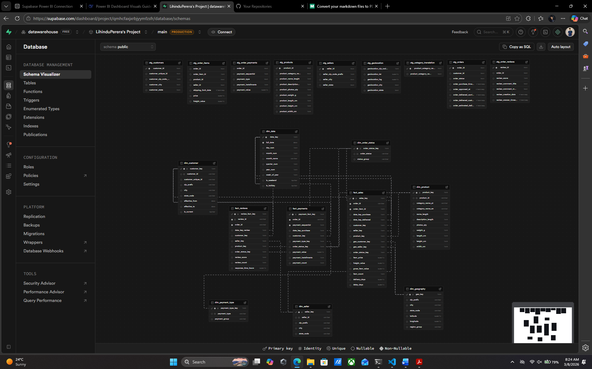
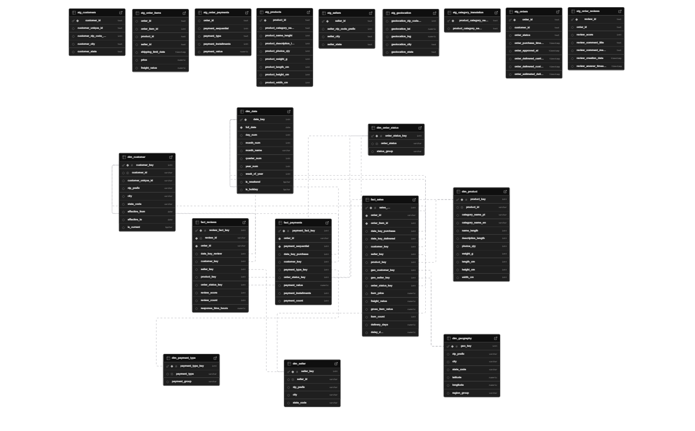
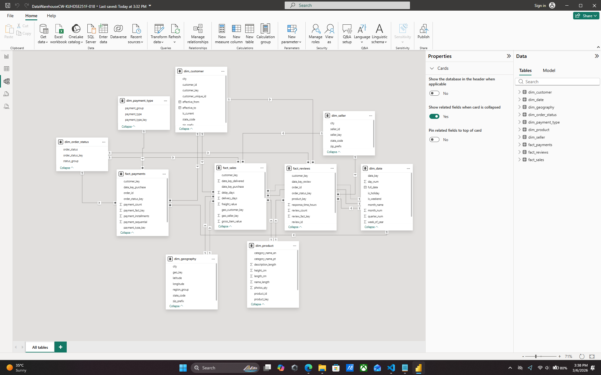
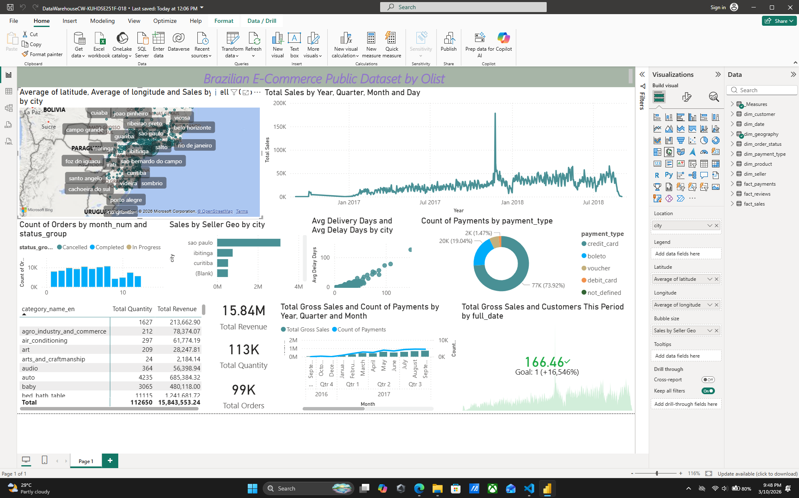

## 1. Introduction

### 1.1 Organizational Background and Business Scenario

The course work is founded on an e-commerce marketplace scenario that is modeled based on Olist data set. The organization in question can be defined as an online marketplace which is multi-vendor and links sellers and buyers in various cities and states. In this type of business, it is a many-seller type, where customers make orders with time, and transactions are done through various means of payments. The company also gathers customer feedback, the delivery milestones and shipping prices.

Most organisations have high volumes of operational data, but most decision-makers are unable to leverage this data due to the fact that they are scattered in various files and systems. In an operational structure, the records of orders are maintained in a different location as compared to the payment records or customer profiles, product characteristics, seller details, and geolocation data. This division is effective in carrying out transactional activities but not analytics. Integrated, historical, and query-optimized structures are it needed by management teams to answer the following questions:

- What are the highest revenue areas?
- What do the product categories stimulate growth?
- Which sellers contain delays that influence the customer satisfaction?
- What is the variation in payment patterns across locations and time?
- What is the situation with customer retention in the long term?

A dashboarding solution and a data warehouse were installed to enhance strategic and tactical decision-making. The warehouse was created in **Supabase PostgreSQL** in the form of staging tables **(stg)** and analytical dimension/fact tables **(dim, fact_)**. The information was then loaded into Power BI to develop interactive reports to the business users.

### 1.2 Why This Dataset Is Suitable

The chosen dataset is quite appropriate to a data warehousing assignment as there are a number of fundamental business entities within it that are inherently suited to dimensional modeling:

- Customers and their localities.
- Lifecycle of orders and order status.
- Realize items of order including prices and freight charges.
- Types of payment and payment transactions.
- Metadata of product category.
- The performance of the sellers and their regions.
- Review scores and timing response.
- Trend analysis date and time attributes.

This organization serves a host of business processes and thus is more suited to a **Galaxy Schema** (fact constellation) design where there are numerous fact tables which have shared dimensions.

### 1.3 Problem Statement and Objectives

This is because the fundamental issue that was discussed in this coursework is the absence of integrated analytical layer of business intelligence. This is aimed at developing a strong decision-support environment by:

1. Combining data of various source formats.
2. The design and deployment of a Galaxy-schema data warehouse.
3. Transformation of staging data to dimensional and fact tables.
4. Constructing ten Power BI visualization analysis.
5. Making sense of trends, patterns and actionable knowledge.
6. Talking about ethics in data and the ethics in analytics.

The end product is a warehouse-supported BI model that helps managers to track the sales, performance of deliveries, payment habits, and customer feelings in a predictable, repeatable and scalable manner.

---

## 2. Design and Implementation of a Data Warehouse

### 2.1 Identify Data Sources

There are at least three types of sources that are required in the assignment. In this implementation, three of the real-life formats were used as the source of the data and then they were loaded into Supabase:

1. **CSV files** (primary operational extracts):
   - `olist_customers_dataset.csv`
   - `olist_orders_dataset.csv`
   - `olist_order_items_dataset.csv`
   - `olist_order_payments_dataset.csv`
   - `olist_order_reviews_dataset.csv` / deduped variant
   - `olist_products_dataset.csv`
   - `olist_sellers_dataset.csv`
   - `olist_geolocation_dataset.csv`

2. **Excel-like tabular source** (category translation in spreadsheet-compatible format):
   - `productcategoryname_translation.csv` (stored as spreadsheet-managed reference/master data; this may be recorded as Excel-managed and then made as CSV to be loaded).

3. **SQL operational source export** (data found in relational tables, converted to CSV, and then staged by loading):
   - The transaction data obtained by an active RDBMS (e.g. MSSQL) and converted into CSV can be defined as orders, payments, and reviews and then be centrally staged in Supabase.

This hybrid source story is a characteristic feature of enterprise practice, which involves analysts combining mixed source formats into one warehouse landing zone.

### 2.2 Source Data Structures and Key Fields

The following source structures were used during staging and modeling:

| Source Entity | Key Fields | Purpose in Analytics |
|---|---|---|
| Customers | `customer_id`, `customer_unique_id`, `customer_city`, `customer_state`, `customer_zip_code_prefix` | Customer profiling, segmentation, regional analysis |
| Orders | `order_id`, `customer_id`, `order_status`, purchase/delivery timestamps | Order lifecycle, fulfillment, time analysis |
| Order Items | `order_id`, `order_item_id`, `product_id`, `seller_id`, `price`, `freight_value` | Revenue and item-level sales facts |
| Payments | `order_id`, `payment_sequential`, `payment_type`, `payment_installments`, `payment_value` | Payment behavior and monetary flow |
| Reviews | `review_id`, `order_id`, `review_score`, creation/answer timestamps | Customer sentiment and response timeliness |
| Products | `product_id`, category, dimensions, weight, media metadata | Product performance and category analysis |
| Sellers | `seller_id`, city/state/zip | Seller performance and geographic spread |
| Geolocation | zip/city/state + lat/long | Map visualizations, regional intelligence |
| Category Translation | Portuguese category to English | Reporting readability and standardization |

### 2.3 Why a Galaxy Schema Was Chosen

A **Galaxy Schema** (fact constellation) was chosen since the business involves multiple processes of analysis which cannot be structured in a clean way using a single fact table:

- Sales process (item level transaction)
- Transaction payment process (payment-sequence-level transactions)
- Review process (review-level events)

The similarities of the dimensions common in these facts are the date, customer, product, seller and order status and hence Galaxy schema is the appropriate design choice. The Galaxy model is better than a single-star design since data duplication is not experienced, there is enhancement in model consistency, and cross-process analysis is enabled.

### 2.4 Warehouse Schema Design

The adopted analytical schema comprises the following:

#### Dimension Tables

- `dim_date`
- `dim_customer`
- `dim_seller`
- `dim_product`
- `dim_geography`
- `dim_order_status`
- `dim_payment_type`

#### Fact Tables

- `fact_sales`
- `fact_payments`
- `fact_reviews`

The structure facilitates time, customer, location, product, seller, status, and payment behavior slicing and dicing.

### 2.5 Fact Table Grain Definition

It is important to define the grain correctly to make the definition unambiguous:

- `fact_sales`: one row per `order_id + order_item_id`
- `fact_payments`: one row per `order_id + payment_sequential`
- `fact_reviews`: one row per `review_id`

The definition of the clear grains makes it such that the aggregated measures like the total sales, the number of payments, and the average review in Power BI are valid.

### 2.6 Measures and Business KPIs Supported

The schema endorses fundamental KPIs, such as:

- Gross sales revenue
- Item quantity sold
- Order count (distinct orders)
- The number of payments and the value of payment.
- Delivery time and delay time.
- Average review score
- Response time to reviews
- Customer and seller regional geographic performance.

### 2.7 Data Cube and Analytical Views

This is achieved through Galaxy design that provides OLAP-type of analysis on the basis of dimensions and measures. Example analysis paths:

- Revenue by `year -> month -> day` and `region_group`
- Seller delivery performance by `seller_id` and `state_code`
- Payment method distribution by `status_group` and period
- Product category sales by location and customer type

The design is conducive to multidimensional exploration that is needed in tactical and strategic planning.

### 2.8 Implementation in Supabase (PostgreSQL)

The schema was modified to Supabase (PostgreSQL), through SQL DDL and DML scripts. It had been applied at two logical layers:

1. **Staging layer (`stg_*`)**
2. **Warehouse layer (`dim_*` and `fact_*`)**

#### Staging Layer

Raw incoming data is inserted into staging layer with minimal transformation and source fidelity is preserved and can be easily troubleshooted. The staging tables are datasets of single sources.

#### Warehouse Layer

The warehouse layer utilizes business-ready structures:

- dimensions (GENERATED BY DEFAULT AS IDENTITY) Surrogate keys.
- Unique integrity constraints and the primary keys.
- Foreign keys between facts and the dimensions.
- Frauds in monetary fields.
- Efficient joining and filtering keys Date keys.

### 2.9 Primary and Foreign Key Relationships

Key relationships implemented:

- `fact_sales.customer_key -> dim_customer.customer_key`
- `fact_sales.seller_key -> dim_seller.seller_key`
- `fact_sales.product_key -> dim_product.product_key`
- `fact_sales.order_status_key -> dim_order_status.order_status_key`
- `fact_sales.date_key_purchase -> dim_date.date_key`
- `fact_sales.date_key_delivered -> dim_date.date_key`
- `fact_sales.geo_customer_key -> dim_geography.geo_key`
- `fact_sales.geo_seller_key -> dim_geography.geo_key`

- `fact_payments.customer_key -> dim_customer.customer_key`
- `fact_payments.payment_type_key -> dim_payment_type.payment_type_key`
- `fact_payments.order_status_key -> dim_order_status.order_status_key`
- `fact_payments.date_key_purchase -> dim_date.date_key`

- `fact_reviews.customer_key -> dim_customer.customer_key`
- `fact_reviews.seller_key -> dim_seller.seller_key`
- `fact_reviews.product_key -> dim_product.product_key`
- `fact_reviews.order_status_key -> dim_order_status.order_status_key`
- `fact_reviews.date_key_review -> dim_date.date_key`

Such relationships were also recreated in Power BI model view as many-to-one relationships between facts and dimensions.

### 2.10 Data Quality and Modeling Decisions

A number of practical design decisions were decided:

- **Date dimension generation:** Constructed using min/max timestamp values in staging, and covers all of the time.
- **Review grain handling:** Since there can be many items in an order and review fact is unique based on `review_id`, a representative item (smallest `order_item_id`) is used to map the products and the seller.
- **Category translation join:** Name names of categories of products are translated into the English counterparts to make the reports clear.
- **Geography aggregation:** Latitude/longitude averaged by zip-city-state combinations.
- **Idempotent upserts:** `ON CONFLICT DO UPDATE` applied to dimensions and facts to facilitate repeatable loads.

### 2.11 Screenshot Placeholder: Supabase Schema





---

## 3. ETL Process (Talend / NiFi Aligned)

### 3.1 ETL Approach Overview

The ETL pipeline is in the typical Extract-Transform-Load design. Although loading was done via Supabase SQL workflows and file imports, the workflow can be directly mapped to Talend/NiFi-style orchestration and can be recorded there to be assessed.

Pipeline stages:

1. **Extract** from source datasets (CSV/Excel-derived files and SQL exports).
2. **Transform** in staging and SQL logic (type casting, deduplication, business rules, key mapping).
3. **Load** Firstly load dimensions, then dependency-safe fact tables.

### 3.2 ETL Source Ingestion

Extraction tasks included:

- Inserting all raw files into staging tables (`stg_customers`, `stg_orders`, `stg_order_items`, etc.).
- Normalization of text and numerical data types.
- Keeping traceability source keys.

In the case that this is applied in Talend, it translates to `tFileInputDelimited`, `tMap` and `tPostgresqlOutput` components.

### 3.3 Transformation Logic

Key transformations that have been done:

- **Date key derivation:** Keys of `YYYYMMDD` integer on the basis of timestamp/date fields.
- **Monetary calculations:** `gross_item_value = price + freight_value`.
- **Delivery metrics:**
  - `delivery_days` calculated using the difference between timestamps of delivery and purchase.
  - `delay_days` based on actual delivery date versus estimated date.
- **Payment grouping:** card/offline/unknown categories.
- **Order status grouping:** Completed/In Progress/Cancelled/Created/Other.
- **Review response time:** Response time Hours between the recording of a review and the time the response was received.
- **Geographic enrichment:** Customer and seller geography keys were calculated by zip/city/state matching.
- **Category translation:** Portuguese category to English of business friendly reporting.

### 3.4 Load Sequence and Dependency Management

The order of the ETL loading is sensitive:

1. `dim_date`
2. `dim_customer`
3. `dim_seller`
4. `dim_product`
5. `dim_geography`
6. `dim_order_status`
7. `dim_payment_type`
8. `fact_sales`
9. `fact_payments`
10. `fact_reviews`

The order being followed will make sure that dimensions have all their foreign keys at hand prior to fact inserts.

### 3.5 Incremental and Repeatable Loads

Repeatability is supported by the process by:

- `ON CONFLICT DO UPDATE` upserts for dimensions and facts.
- optional full refresh script `TRUNCATE ... RESTART IDENTITY`.
- Checking the number of rows and percentages of null foreign keys by querying.

### 3.6 Data Validation and Reconciliation

Post-load validation checks included:

- Table-level row counts for each dimension and fact.
- Orphan checks (`customer_key IS NULL`, `payment_type_key IS NULL`, `product_key IS NULL`).
- Natural business key validation and constraints.

These checks help to give an assurance that the outputs of the analysis using power BI are founded upon reliable and complete warehouse data.

### 3.7 Error Handling and Operational Notes

An ETL workflow of production grade should have:

- Malformed record handling.
- Record of load start/end times and rows.
- Signaling schema drift or spikes of unexpected null.
- Metadata table that would monitor batch IDs and run status.

This would translate to the addition of monitoring processors/components and persistent ETL audit logs in the terms of the Talend/NiFi.

---

## 4. Data Analysis and Visualization in Power BI

In the analysis of performance in the areas of sales, geography, time, payment behavior, fulfillment efficiency, and customer feedback, ten images were created. Each of the visuals and the insights gained is summarized in the following sections.

### 4.1 Visualization 1: Map (Bubble/Filled) - Sales by Geography

**Business objective:** To find the locations that have good performance and low performance.

**Data used:**

- Location: `dim_geography[city]`, `state_code`, `region_group`
- Coordinates: `latitude`, `longitude`
- Measure: `Sales by Seller Geo` or `Sales by Customer Geo`

**DAX Example:**

```dax
Sales by Seller Geo =
CALCULATE(
    SUM(fact_sales[gross_item_value]),
    USERELATIONSHIP(fact_sales[geo_seller_key], dim_geography[geo_key])
)
```

**Interpretation:**

The map presents the business concentration in the regions. Bubbles of sales in urban clusters are much bigger than the smaller areas of the interior. This shows that market penetration, density of the sellers and logistics maturity is not evenly distributed across the regions. This can be used by decision makers to determine areas where their expansion opportunities are.

### 4.2 Visualization 2: Clustered Bar Chart - Sales by City/Seller

**Business objective:** Prioritize entities by the contribution to revenue.

**Data used:**

- Axis: `city` or `seller_id`
- Values: `Total Gross Sales`
- Optional legend: seller or category segments

**Interpretation:**

The chart brings out a typical Pareto trend in which few cities or sellers bring in a huge percentage of revenue. This allows differentiated strategy: the top sellers can be retained and development plans can be made of the long-tail contributors.

### 4.3 Visualization 3: Line Chart - Sales Trend Over Time

**Business objective:** Discover seasonality, growth, and volatility.

**Data used:**

- Axis: `dim_date[full_date]`, month, year
- Value: `Total Gross Sales`

**DAX Example:**

```dax
Total Gross Sales = SUM(fact_sales[gross_item_value])
```

**Interpretation:**

Time-series movement typically reflects trend waves which are associated with promotions, holidays and inventory cycles. Management is able to measure the rates of monthly growth and the time when campaigns should be done.

### 4.4 Visualization 4: Matrix/Table - Top Products and Categories

**Business objective:** Learn what products/categories are volume and value drivers.

**Data used:**

- Rows: `category_name_en`, `product_id`
- Values: quantity, revenue

**DAX Examples:**

```dax
Total Quantity = SUM(fact_sales[item_count])
Total Revenue = SUM(fact_sales[gross_item_value])
```

**Interpretation:**

This outlook tends to show variations among high volume low value products and low volume high margin products. This can be used to optimize by product managers assortment, pricing and promotions.

### 4.5 Visualization 5: Pie/Donut - Payment Type Breakdown

**Business objective:** Examine the preferences of customers in terms of payment.

**Data used:**

- Legend: `dim_payment_type[payment_type]`
- Values: number of payment or amount of payment.

**DAX Example:**

```dax
Count of Payments = COUNTROWS(fact_payments)
```

**Interpretation:**

The type of shares in payment offers an understanding of the trust, convenience, and demographic inclinations. When it comes to card dominance, optimization of checkout needs to focus on card UX. In the case of alternative methods being important, alliances and optimization of fees are applicable.

### 4.6 Visualization 6: Stacked Column - Orders by Status Over Time

**Business objective:** Monitor the healthy operation in fulfillment pipeline.

**Data used:**

- Axis: month/year
- Legend: `status_group`
- Value: distinct order count

**DAX Example:**

```dax
Count of Orders = DISTINCTCOUNT(fact_sales[order_id])
```

**Interpretation:**

High ratio of the delivered is a sign of stability of operations. The cancelled/unavailable states spikes indicate the inventory, seller compliance, or logistic problems which demand urgent intervention.

### 4.7 Visualization 7: Scatter Plot - Delivery Days vs Delay Days

**Business objective:** Compare logistics performance by sellers/regions.

**Data used:**

- X axis: average delivery days
- Y axis: average delay days
- Detail: seller or city

**DAX Examples:**

```dax
Avg Delivery Days = AVERAGE(fact_sales[delivery_days])
Avg Delay Days = AVERAGE(fact_sales[delay_days])
```

**Interpretation:**

The most performers are located in the lower-left (faster and less delayed). High-delay root causes must be identified and analyzed in terms of operational root causes, SLA, and scrutiny of shipping partners.

### 4.8 Visualization 8: KPI Cards - High-Level Executive Metrics

**Business objective:** Provide at-a-glance performance monitoring.

**Metrics displayed:**

- Total Gross Sales
- Total Orders
- Average Review Score

**DAX Examples:**

```dax
Total Orders = DISTINCTCOUNT(fact_sales[order_id])
Avg Review Score = AVERAGE(fact_reviews[review_score])
```

**Interpretation:**

Cards provide rapid executive visibility and are effective for weekly business reviews. Combined with period filters, they support trend-aware KPI tracking.

### 4.9 Visualization 9: Combo Chart - Sales vs Payment Activity

**Business objective:** Compare value flow and transaction activity time.

**Data used:**

- Shared axis: date
- Column: gross sales
- Line: payment count

**Interpretation:**

The discrepancy between the sales value and the number of payment may reflect average changes of basket values. In such a case, when the sales increase with constant number of payments, then this implies increased order values.

### 4.10 Visualization 10: KPI/Trend - Customer Retention Proxy

**Business objective:** Compare active customers of current period with competing one of previous periods.

**DAX Examples:**

```dax
Customers This Period = DISTINCTCOUNT(fact_sales[customer_key])

Customers Last Period =
CALCULATE(
    [Customers This Period],
    DATEADD(dim_date[full_date], -1, MONTH)
)
```

**Interpretation:**

This pair of measures approximates to retention momentum. An increase implies an augmentation of recursive buying conduct; the downward trend may initiate customer relationship initiatives and service quality enhancement.

### 4.11 Cross-Visualization Trends and Pattern Summary

In all the pictures, one can speak about the following general categories of patterns:

- Revenue location within areas of choice of urban/strong-commerce.
- Unequal performance of sellers with the best performers taking over the value.
- Obvious time-based variability which indicates seasonality.
- Variation in delivery performance directly correlated with the proxies of customer satisfaction.
- Channel-specific optimization of payment behavior disparity.

These results show that a linked warehouse model can allow integrated business analysis to be run, as opposed to isolated reporting.

### 4.12 Screenshot Placeholders: Power BI





---

## 5. Data Ethics

Driven decision-making Data-driven decision-making is capable of producing business value, but it also imposes ethical obligations. The issues to be applicable to this project are as follows.

### 5.1 Privacy and Personal Data Protection

Although personal identifiers might be direct (e.g., names, etc.), location and behavioral information can still constitute a re-identification risk. When the combination of zip code, city, and purchase behavior is involved, it makes the combination sensitive. This must be done ethically by reducing the amount of personally identifiable information and by taking care of role-based access control in reporting.

### 5.2 Purpose Limitation and Responsible Use

The unrelated or intrusive profiling by using the data gathered to perform transactions should not be done unless there is a legal and ethical reason. The warehouse is supposed to fulfill specific business purposes including operations enhancement, quality in customer service, and strategic planning.

### 5.3 Bias and Fairness in Interpretation

Comparisons between regions and sellers may make unwanted judgments when factors of context are not taken into consideration (infrastructure differences, distance, mix of products). Before punishing underperformers without the analysis of the root causes, ethical analytics is cautious.

### 5.4 Data Quality and Misleading Conclusions

Wrong decisions may come as a result of inaccurate, incomplete, or delayed data. Transparency of data limits, assumptions known, and model constraints are also ethical contents that need to be reported. Example: review-to-product mapping through first order item is a deliberate tradeoff in modeling and needs to be recorded.

### 5.5 Security and Access Governance

The BI assets and warehouse assets should be safeguarded by:

- Least-privilege access
- Credential management
- Audit logging
- Sharing of dashboard links is controlled.

This avoids unauthorized use and accountability is ensured.

### 5.6 Ethical Recommendations for This Project

- Cover or blend sensitive location information where necessary.
- Show assumptions of the documents in the report and dashboard metadata.
- Authenticate important metrics prior to executive reporting.
- Enforce retention policies on staging raw data.
- Make sure that the law is satisfied with the data protection principles.

---

## 6. Conclusion

This course work illustrates an entire business intelligence life cycle: source integration, data warehouse architecture, ETL, and dashboard analytics. To represent the numerous interrelated processes (sales, payments, reviews), a Galaxy schema was rightfuly chosen to be shared by common dimensions. Staging and dimensional layers were used to implement the warehouse in Supabase and the key constraints and foreign keys were used to preserve the integrity.

Analytically, the power BI dashboard can provide a complete decision support using 10 visualizations. The model assists in analysis of region, product/category performance, seller operation, payment and customer sentiment trend. The integration of these views would help the management to have a better idea of what contributes to revenue, where delays exist, and which processes should be optimized.

### 6.1 Overall Findings, Trends, and Patterns

According to the integrated model, there are a number of strategic patterns:

- Selection of locations and the highest contributors in terms of revenue.
- Varying performance among sellers and logistics results.
- Demand variations with time implying seasonality.
- Status (experience) and delay (experience) connected with operational indicators (reviews).
- Partnership and checkout strategy can depend on unique payment preferences.

### 6.2 Business Intelligence Value Obtained

A BI value of the next magnitude is obtained:

- **Strategic planning:** Improved expansion and targeting of the market regionally.
- **Operational improvement:** The discovery of delivery bottlenecks and service risk points.
- **Commercial optimization:** Special treatment of products, sellers and categories.
- **Customer management:** The review signals and repeat activity monitoring.
- **Executive alignment:** KPI visibility based on one governed data model.

All in all, the project has demonstrated that data warehousing and visualization can be utilized to convert raw data in transactions into actionable intelligence. This helps in speedy, evidence based decision making and enhances performance within a company.